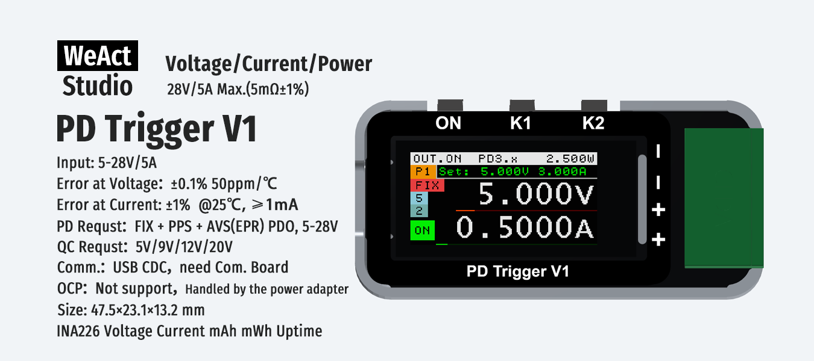

# WeAct Studio PD Trigger V1 User Manual



## 1. Specifications

| Item | Value |
|---|---|
| Input | 5–28 V / 5 A Max |
| Error at Voltage | ±0.1%, 50 ppm/°C |
| Error at Current | ±1% (@25 °C, ≥1 mA) |
| Shunt Resistor | 5 mΩ ±1% |
| PD Request | FIX + PPS + AVS(EPR) PDO, 5–28 V |
| QC Request | 5 / 9 / 12 / 20 V |
| Comm. | USB CDC virtual COM port (Com. Board required) |
| OCP | Not supported (handled by the power adapter) |
| Size | 47.5 × 23.1 × 13.2 mm |
| Metering IC | INA226 (voltage / current / mAh / mWh / uptime) |

## 2. Buttons

Three buttons: **ON**, **K1**, **K2**.

- **Short press**: press and release
- **Long press**: hold for about 1 s until the key indicator area shows `W.`, then release
- **ON** works on all screens

### 2.1 Button function summary

| Button | Main | Profile selection | Voltage adjustment | Setup menu |
|---|---|---|---|---|
| **ON** | Short press: toggle output (OUT.ON / OUT.OFF) | Same | Same | Same |
| **K1** | Short press: enter profile selection (when input is PD or QC)<br>Long press: enter setup menu | Short press: previous profile<br>Long press: cancel and return | Short press: decrease voltage (or current)<br>Long press: confirm and return | Short press: next item<br>Long press: save and exit |
| **K2** | Short press: switch display page (Base → Detail 1 → Detail 2)<br>Long press: clear max values (Vm / Im / Pm) and mAh / mWh | Short press: next profile<br>Long press: confirm and apply this profile | Short press: increase voltage (or current)<br>Hold ~1 s until `W.` appears, then release: switch step size<br>Keep holding after `W.` appears: switch adjust target (voltage ↔ current) | Short press: change the value of the current item |

- Main screen pages: Base (large voltage / current + bar graphs) → Detail 1 (Vol, Cur, mAh, mWh, UpT) → Detail 2 (Vm, Im, Pm)
- Adjustment steps: voltage 20 mV / 100 mV / 500 mV / 1 V; current 50 / 100 / 500 / 1000 mA
- Profile selection returns to the main screen after 10 s idle; setup menu saves and exits after 10 s idle

### 2.2 Setup items (entered by K1 long press)

| Item | Description | Value |
|---|---|---|
| Brightness | Screen brightness | 0–10 |
| Screen Idle Off | Auto screen off after 10 s idle | OFF(0) / ON(1) |
| Screen Reverse | Rotate screen 180° | OFF(0) / ON(1) |
| Output Record | Remember the output profile, restore on next power-up | OFF(0) / ON(1) |
| Power Up OUT.ON | Turn output on automatically at power-up | OFF(0) / ON(1) |
| VSHCT | Shunt voltage conversion time | 140 µs – 8.244 ms |
| VBUSCT | Bus voltage conversion time | 140 µs – 8.244 ms |
| AVG | Averaging count | 1 / 4 / 16 / 64 / 128 / 256 / 512 / 1024 |
| Cur. LSB | Current resolution | 0.1 – 1.0 mA |
| Cur. Offset | Current zero calibration | ±1.5 mA |
| Power Offset | Power zero calibration | ±15 mW |
| Factory Reset | Restore factory settings | OFF(0) / ON(1) (applied on exit) |
| MFR | Manufacturer | WeAct Studio (read-only) |
| MOD | Model | PD Trigger V1 (read-only) |
| S/N | Serial number | 12 hex digits (read-only) |
| (last item) | Firmware version | read-only |

## 3. Communication Protocol

### 3.1 Physical layer

- Interface: USB CDC virtual COM port
- Requires the **Com. Board** to connect to the device
- Baud rate follows the USB CDC default, no configuration needed

### 3.2 Frame format

- All multi-byte values are **little-endian**
- Frame terminator is `0x0A`

**Host → Device (request)**

```
<command> [parameters…] 0x0A
```

Bit 7 of the command byte set to 1 marks a read request (`command | 0x80`).

**Device → Host (response)**

```
<command|0x80> [length u8] <data…> 0x0A
```

For text responses (model / version / serial number), the second byte is the text length; frames can also be split by the `0x0A` terminator.

### 3.3 Command table — Read

Below are the **request** frames; the first byte of every response is `command | 0x80`.

| Command | Code | Request | Response data | Notes |
|---|---|---|---|---|
| WHO_AM_I | 0x01 | `81 0A` | `length u8 + "WeAct Studio PD Trigger V1"` | Model |
| OUTPUT_DATA | 0x02 | `82 0A` | `V u32, I i32, P u32` | Live: mV / 0.1 mA / mW |
| OUTPUT_DATA_MAX | 0x03 | `83 0A` | `V u32, I i32, P u32` | Max values, same units |
| MAH_MWH | 0x04 | `84 0A` | `mAh u32, mWh u32` | Accumulated energy |
| UPTIME | 0x05 | `85 0A` | `seconds u32` | Uptime |
| INPUT_TYPE | 0x07 | `87 0A` | `type u8` | 1=PD 2=QC 3=DC 4=none |
| PD_PDO_FIX | 0x08 | `88 0A` | `length u8, (V u16, I u16)×n` | Fixed profiles; length = 4×n; mV / mA |
| PD_PDO_PPS | 0x09 | `89 0A` | `length u8, (Vmin u16, Vmax u16, Imax u16)×n` | PPS profiles; length = 6×n; mV / mA |
| PD_PDO | 0x0A | `8A 0A` | `id u8, V u16` | Current fixed profile; mV |
| PD_PDO_AVS | 0x0B | `8B 0A` | `length u8, (Vmin u16, Vmax u16, P u16)×n` | AVS profiles; length = 6×n; mV / **W** |
| PD_PDO_NUM | 0x0C | `8C 0A` | `fixed u8, PPS u8, AVS u8` | Profile counts |
| PD_PDO2 | 0x0D | `8D 0A` | `id u8, V u16, I u16` | Current profile (with current limit); mV / mA |
| OUTPUT_ENABLE | 0x0E | `8E 0A` | `state u8` | 0=off 1=on |
| SYSTEM_VERSION | 0x42 | `C2 0A` | `length u8 + "V<a>.<b>.<c>.<d>_<crc32>"` | Firmware version |
| SYSTEM_SERIAL_NUM | 0x43 | `C3 0A` | `length u8 + "xxxxxxxxxxxx"` | Serial number |
| SYSTEM_LCD_PANEL_TYPE | 0x46 | `C6 0A` | `type u8` | 0=HAN 1=BOE |
| SYSTEM_CURRENT_RSHUNT | 0x47 | `C7 0A` | `rshunt u8` | Shunt resistor, 1 mΩ/LSB |
| SYSTEM_CURRENT_OFFSET | 0x48 | `C8 0A` | `display0 i32, actual0 i32, display1 i32, actual1 i32, zero i32` | Current calibration data; little-endian, 20 bytes total |
| SYSTEM_INA226_CONFIG | 0x49 | `C9 0A` | `CurLSB u8, Config u16` | INA226 configuration |

### 3.4 Command table — Write

| Command | Code | Request | Notes |
|---|---|---|---|
| OUTPUT_DATA_MAX_RESET | 0x06 | `06 0A` | Clear max values and mAh / mWh |
| PD_PDO | 0x0A | `0A <id u8> <V u16> 0A` | Select fixed profile; mV |
| PD_PDO2 | 0x0D | `0D <id u8> <V u16> <I u16> 0A` | Select profile (with current); mV / mA |
| OUTPUT_ENABLE | 0x0E | `0E <state u8> 0A` | Toggle output; 0=off 1=on |
| SYSTEM_RESET | 0x40 | `40 0A` | Reset the device |
| SYSTEM_UPGRADE | 0x41 | `41 A5 AA 0A` | Reboot into firmware upgrade mode |
| SYSTEM_FACTORY_RESET | 0x45 | `45 0A` | Restore factory settings and reset |
| SYSTEM_LCD_PANEL_TYPE | 0x46 | `46 <type u8> 0A` | Set LCD panel type |
| SYSTEM_CURRENT_RSHUNT | 0x47 | `47 <rshunt u8> 0A` | Set shunt resistor |
| SYSTEM_CURRENT_OFFSET | 0x48 | `48 <display0 i32> <actual0 i32> <display1 i32> <actual1 i32> <zero i32> 0A` | Set current calibration data; zero limited to ±15 |
| SYSTEM_INA226_CONFIG | 0x49 | `49 <CurLSB u8> <Config u16> 0A` | Set INA226 configuration |

### 3.5 Communication app

Web-based monitor console, **no installation**:

- URL: <https://tools.weactstudio.com/PDTriggerMonitor/>
- Browser: desktop Chrome / Edge (Web Serial)
- Features: live voltage / current / power, browse and switch PDO profiles, INA226 sampling and trend charts
- Runs locally, no data leaves your machine
- **Offline copy**: `Tools/PDTriggerMonitor/index.html` — just double-click to open in a browser, no network needed

## 4. Firmware Upgrade

Two methods are available; either one works. Both use `.fpk` firmware packages.

> Connect the device with a data cable first. Do not cut power or unplug during the upgrade.

### Method 1: Web upgrade

1. Open <https://tools.weactstudio.com/FirmwareUpdater/>
2. Click "Connect Device" and pick the device port in the popup
3. Click "Check for Updates"; the tool compares against the latest version in the catalog
4. Verify model and CRC, check the risk confirmation, then click "Start Upgrade"
5. Wait for it to finish (reboot to bootloader → flash → read back and verify)

- **Works offline**: click "Select local firmware…" and pick an `.fpk` file directly.
- **Offline copy**: `Tools/FirmwareUpdater/index.html` — just double-click to open in a browser; same features as the web version, and the version catalog falls back to the last cached list when offline.

### Method 2: Local tool upgrade

Use the official tool `WeActStudio_Upgrade_Tool` (in the `Tools` folder).

1. Extract `Tools/WeActStudio_Upgrade_Tool.7z`
2. Run `WeActStudio_Upgrade_Tool/64bit/WeActStudio_Upgrade_Tool.exe`
3. Connect the device with a data cable
4. Select the `.fpk` firmware
5. Open the serial port
6. Click "Send" to start the upgrade

> For 32-bit systems / Win7, use the program in the `32bit_Win7` folder.
>
> Command-line version: extract `Tools/WeActStudio_Upgrade_Tool_Python.7z` and run `python WeActStudio_Upgrade_Tool.py [port] firmware.fpk` (the port can be omitted for auto search; requires Python and pyserial).

### Rescue: device will not start

If the device does not respond and neither method above can enter upgrade mode (handled by the bootloader, so it works even when the app is corrupt):

1. Remove power from the device
2. Hold **K2**
3. Connect the device to the PC with a data cable (keep holding K2)
4. Release K2 once the PC detects the device
5. Flash the `.fpk` using either method above

## 5. Release Notes

**V1.0.0.0** Initial version.
