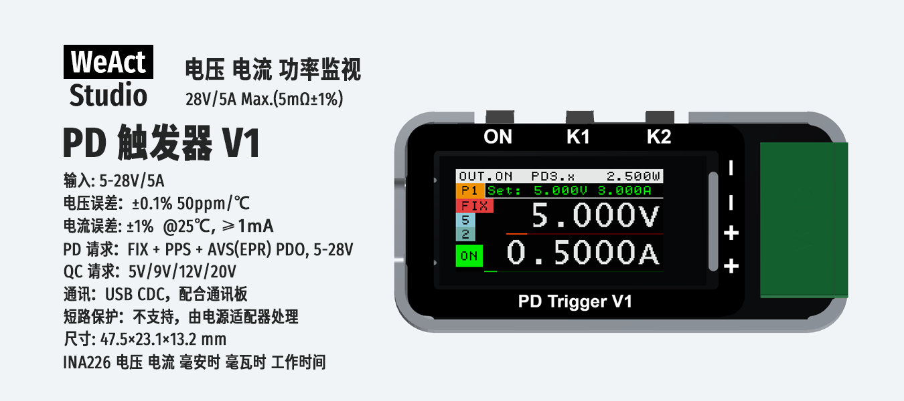

# WeAct Studio PD Trigger V1 使用说明



## 1. 规格

| 项目 | 参数 |
|---|---|
| 输入 | 5–28 V / 5 A Max |
| 电压测量误差 | ±0.1%，50 ppm/°C |
| 电流测量误差 | ±1%（@25 °C，≥1 mA） |
| 采样电阻 | 5 mΩ ±1% |
| PD 请求 | FIX + PPS + AVS(EPR) PDO，5–28 V |
| QC 请求 | 5 / 9 / 12 / 20 V |
| 通讯 | USB CDC 虚拟串口（需通讯板） |
| 短路保护 | 不支持（由电源适配器处理） |
| 尺寸 | 47.5 × 23.1 × 13.2 mm |
| 计量芯片 | INA226（电压 / 电流 / mAh / mWh / 工作时长） |

## 2. 按键

三个按键：**ON**、**K1**、**K2**。

- **短按**：按下后松开
- **长按**：按住约 1 s，屏幕按键提示区出现 `W.` 后松开
- **ON** 在所有界面均有效

### 2.1 按键功能汇总

| 按键 | 主界面 | 档位选择页 | 调压页 | 设置菜单 |
|---|---|---|---|---|
| **ON** | 短按：开 / 关输出（OUT.ON / OUT.OFF） | 同左 | 同左 | 同左 |
| **K1** | 短按：进入档位选择（输入为 PD 或 QC 时）<br>长按：进入设置菜单 | 短按：上一档<br>长按：取消并返回 | 短按：减小电压（或电流）<br>长按：确认并返回 | 短按：下一项<br>长按：保存并退出 |
| **K2** | 短按：切换显示页（基础 → 详细 1 → 详细 2）<br>长按：清零最大值（Vm / Im / Pm） | 短按：下一档<br>长按：确认并应用该档位 | 短按：增大电压（或电流）<br>长按约 1 s（出现 `W.`）后松开：切换步进<br>出现 `W.` 后继续按住：切换调节对象（电压 ↔ 电流） | 短按：修改当前项的值 |

- 主界面显示页：基础（电压 / 电流大字 + 条形图）→ 详细 1（Vol、Cur、mAh、mWh、UpT）→ 详细 2（Vm、Im、Pm）
- 调压页步进：电压 20 mV / 100 mV / 500 mV / 1 V；电流 50 / 100 / 500 / 1000 mA
- 档位选择页无操作 10 秒自动返回主界面；设置菜单无操作 10 秒自动保存退出

### 2.2 设置项（K1 长按进入）

| 设置项 | 说明 | 取值 |
|---|---|---|
| Brightness | 屏幕亮度 | 0–10 |
| Screen Idle Off | 无操作 10 秒自动息屏 | OFF(0) / ON(1) |
| Screen Reverse | 屏幕旋转 180° | OFF(0) / ON(1) |
| Output Record | 记录输出档位，下次上电恢复 | OFF(0) / ON(1) |
| Power Up OUT.ON | 上电自动打开输出 | OFF(0) / ON(1) |
| VSHCT | 分流电压转换时间 | 140 µs – 8.244 ms |
| VBUSCT | 总线电压转换时间 | 140 µs – 8.244 ms |
| AVG | 平均次数 | 1 / 4 / 16 / 64 / 128 / 256 / 512 / 1024 |
| Cur. LSB | 电流分辨率 | 0.1 – 1.0 mA |
| Cur. Offset | 电流零点校准 | ±1.5 mA |
| Power Offset | 功率零点校准 | ±15 mW |
| Factory Reset | 恢复出厂设置 | OFF(0) / ON(1)（退出时执行） |
| MFR | 厂商 | WeAct Studio（只读） |
| MOD | 型号 | PD Trigger V1（只读） |
| S/N | 序列号 | 12 位十六进制（只读） |
| （末项） | 固件版本 | 只读 |

## 3. 通讯协议

### 3.1 物理层

- 接口：USB CDC 虚拟串口
- 需要 **通讯板** 连接设备的通讯接口
- 波特率等参数由 USB CDC 默认值决定，无需设置

### 3.2 帧格式

- 所有多字节数值为 **小端（little-endian）**
- 帧尾固定为 `0x0A`

**主机 → 设备（请求）**

```
<命令码> [参数…] 0x0A
```

命令码 bit7 = 1 表示读请求（`命令码 | 0x80`）。

**设备 → 主机（应答）**

```
<命令码|0x80> [长度 u8] <数据…> 0x0A
```

文本类应答（型号 / 版本 / 序列号）第二字节为文本长度，可直接按帧尾 `0x0A` 切帧。

### 3.3 命令表 — 读取

下面是**请求**帧；应答首字节均为 `命令码 | 0x80`。

| 命令 | 命令码 | 请求帧 | 应答数据 | 说明 |
|---|---|---|---|---|
| WHO_AM_I | 0x01 | `81 0A` | `长度 u8 + "WeAct Studio PD Trigger V1"` | 型号 |
| OUTPUT_DATA | 0x02 | `82 0A` | `V u32, I i32, P u32` | 实时值：mV / 0.1 mA / mW |
| OUTPUT_DATA_MAX | 0x03 | `83 0A` | `V u32, I i32, P u32` | 最大值，单位同上 |
| MAH_MWH | 0x04 | `84 0A` | `mAh u32, mWh u32` | 累计电量 |
| UPTIME | 0x05 | `85 0A` | `秒 u32` | 工作时长 |
| INPUT_TYPE | 0x07 | `87 0A` | `类型 u8` | 1=PD 2=QC 3=DC 4=无 |
| PD_PDO_FIX | 0x08 | `88 0A` | `长度 u8, (V u16, I u16)×n` | 固定档：n 档；长度 = 4×n；mV / mA |
| PD_PDO_PPS | 0x09 | `89 0A` | `长度 u8, (Vmin u16, Vmax u16, Imax u16)×n` | PPS 档；长度 = 6×n；mV / mA |
| PD_PDO | 0x0A | `8A 0A` | `id u8, V u16` | 当前固定档；mV |
| PD_PDO_AVS | 0x0B | `8B 0A` | `长度 u8, (Vmin u16, Vmax u16, P u16)×n` | AVS 档；长度 = 6×n；mV / **W** |
| PD_PDO_NUM | 0x0C | `8C 0A` | `固定数 u8, PPS 数 u8, AVS 数 u8` | 各档位数量 |
| PD_PDO2 | 0x0D | `8D 0A` | `id u8, V u16, I u16` | 当前档（含电流上限）；mV / mA |
| OUTPUT_ENABLE | 0x0E | `8E 0A` | `状态 u8` | 0=关 1=开 |
| SYSTEM_VERSION | 0x42 | `C2 0A` | `长度 u8 + "V<a>.<b>.<c>.<d>_<crc32>"` | 固件版本 |
| SYSTEM_SERIAL_NUM | 0x43 | `C3 0A` | `长度 u8 + "xxxxxxxxxxxx"` | 序列号 |
| SYSTEM_LCD_PANEL_TYPE | 0x46 | `C6 0A` | `类型 u8` | 0=HAN 1=BOE |
| SYSTEM_CURRENT_RSHUNT | 0x47 | `C7 0A` | `阻值 u8` | 采样电阻，1 mΩ/LSB |
| SYSTEM_CURRENT_OFFSET | 0x48 | `C8 0A` | `display0 i32, actual0 i32, display1 i32, actual1 i32, zero i32` | 电流校准参数；小端，共 20 字节 |
| SYSTEM_INA226_CONFIG | 0x49 | `C9 0A` | `CurLSB u8, Config u16` | INA226 配置 |

### 3.4 命令表 — 写入

| 命令 | 命令码 | 请求帧 | 说明 |
|---|---|---|---|
| OUTPUT_DATA_MAX_RESET | 0x06 | `06 0A` | 清零最大值与 mAh / mWh |
| PD_PDO | 0x0A | `0A <id u8> <V u16> 0A` | 选择固定档；mV |
| PD_PDO2 | 0x0D | `0D <id u8> <V u16> <I u16> 0A` | 选择档位（含电流）；mV / mA |
| OUTPUT_ENABLE | 0x0E | `0E <状态 u8> 0A` | 开关输出；0=关 1=开 |
| SYSTEM_RESET | 0x40 | `40 0A` | 复位设备 |
| SYSTEM_UPGRADE | 0x41 | `41 A5 AA 0A` | 重启进入固件升级模式 |
| SYSTEM_FACTORY_RESET | 0x45 | `45 0A` | 恢复出厂设置并复位 |
| SYSTEM_LCD_PANEL_TYPE | 0x46 | `46 <类型 u8> 0A` | 设置屏型号 |
| SYSTEM_CURRENT_RSHUNT | 0x47 | `47 <阻值 u8> 0A` | 设置采样电阻 |
| SYSTEM_CURRENT_OFFSET | 0x48 | `48 <display0 i32> <actual0 i32> <display1 i32> <actual1 i32> <zero i32> 0A` | 设置电流校准参数；zero 限 ±15 |
| SYSTEM_INA226_CONFIG | 0x49 | `49 <CurLSB u8> <Config u16> 0A` | 设置 INA226 配置 |

### 3.5 通讯应用

网页版监控控制台，**免安装**：

- 地址：<https://tools.weactstudio.com/PDTriggerMonitor/>
- 浏览器：桌面版 Chrome / Edge（Web Serial）
- 功能：实时读取电压 / 电流 / 功率、浏览并切换 PDO 档位、INA226 采样与趋势绘图
- 数据不出本机
- **离线副本**：`Tools/PDTriggerMonitor/index.html`，双击用浏览器打开即可，无需联网

## 4. 固件升级

设备有两套升级方式，任选其一，均使用 `.fpk` 固件包。

> 升级前请用数据线连接设备，升级过程中不要断电或拔线。

### 方式一：网页升级

1. 打开 <https://tools.weactstudio.com/FirmwareUpdater/>
2. 点「连接设备」，在弹窗中选择设备串口
3. 点「检查更新」，工具自动比对目录里的最新版本
4. 核对型号与 CRC，勾选风险确认后点「开始升级」
5. 等待自动完成（重启进 bootloader → 刷入 → 回读校验）

- **无需联网**：点「本地选取固件…」直接选一个 `.fpk` 文件即可刷入。
- **离线副本**：`Tools/FirmwareUpdater/index.html`，双击用浏览器打开即可，功能与网页版一致；离线时版本目录会自动回落到上次缓存的清单。

### 方式二：本地工具升级

使用官方升级工具 `WeActStudio_Upgrade_Tool`（在 `Tools` 文件夹）。

1. 解压 `Tools/WeActStudio_Upgrade_Tool.7z`
2. 运行 `WeActStudio_Upgrade_Tool/64bit/WeActStudio_Upgrade_Tool.exe`
3. 用数据线连接设备
4. 选择 `.fpk` 固件
5. 打开串口
6. 点「发送」按钮开始升级

> 32 位系统 / Win7 请使用 `32bit_Win7` 目录下的程序。
>
> 命令行版：解压 `Tools/WeActStudio_Upgrade_Tool_Python.7z`，运行 `python WeActStudio_Upgrade_Tool.py [串口] 固件.fpk`（串口可省略，自动搜索；需 Python 与 pyserial）。

### 设备无法开机时（救砖）

设备无响应、上面两种方式都进不了升级模式时（由 bootloader 处理，APP 损坏同样有效）：

1. 断开设备电源
2. 按住 **K2** 不放
3. 用数据线连接电脑（全程按住 K2）
4. 电脑识别到设备后松开 K2
5. 按上面任一方式刷入 `.fpk`

## 5. 版本历史

**V1.0.0.0** 初始版本。
